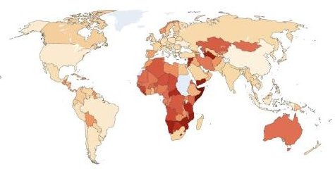

# FoodSecurity Atlas: Global Crop and Hunger Risk Map

[](https://github.com/saphal-sharma/foodsecurity-atlas/actions/workflows/tests.yml)

**▶ Live map: [saphal-sharma.github.io/foodsecurity-atlas](https://saphal-sharma.github.io/foodsecurity-atlas/)**

> **Question:** Which countries face the highest risk to their own cereal production?  
> **Answer:** Africa's median risk (0.68) is almost twice Europe's (0.36). Highest risk: Somalia, Yemen, Mozambique, Zimbabwe and Turkmenistan.  
> **Method:** FAO and World Bank data loaded into SQLite; each indicator percentile-ranked in SQL and averaged into a transparent index; interactive Plotly map for 176 countries.




An interactive world map that compares agricultural production, population pressure, hunger and rainfall across countries, combined into a **transparent risk index**. The data pipeline runs on **SQL (SQLite)** and **Python**, and the map is built with **Plotly**.

Open the interactive map: [`results/atlas.html`](results/atlas.html). Use the dropdown to switch between layers and hover over a country for its values.

## Indicators

| Indicator | Source | Higher risk when |
|---|---|---|
| Cereal yield, 2014–18 | FAO via Our World in Data | yield is low |
| Cereal yield trend, 1999–2018 | FAO via Our World in Data | yields are stagnating or falling |
| Yield volatility (detrended CV) | FAO via Our World in Data | harvests swing strongly between years |
| Population growth, 2015–2025 | World Bank via datahub | demand grows fast |
| Undernourishment (% of population)* | FAO SDG 2.1.1 via World Bank API | more people are undernourished |
| Average precipitation (mm/yr)* | World Bank API | the country is drier |

*Added when you run `src/fetch_worldbank.py` (see below).

**Risk index:** each indicator is converted to a percentile rank across countries in SQL (`PERCENT_RANK()`), where 0 is the lowest risk and 1 the highest. The index is the simple average of the available ranks. Equal weights keep the method transparent, and they can be changed in [`sql/`](sql/).

## Results (production indicators, 176 countries)

| Region | Median risk index | Median cereal yield (t/ha) | Population growth (%/yr) |
|---|---|---|---|
| Africa | 0.68 | 1.32 | 2.37 |
| Americas | 0.43 | 3.54 | 0.77 |
| Asia | 0.43 | 3.13 | 1.34 |
| Oceania | 0.41 | 2.63 | 1.45 |
| Europe | 0.36 | 4.95 | 0.26 |

The highest-risk countries are **Somalia, Yemen, Mozambique, Zimbabwe and Turkmenistan**. They combine low or falling cereal yields, very volatile harvests and fast population growth. Africa's median risk is almost twice Europe's: its cereal yields are about a quarter of Europe's, and its population grows about nine times faster.

**Interpretation note:** the index measures production risk, not hunger itself. A few countries with small, rainfed cereal sectors but low hunger (for example Cyprus) rank high because their yields are low and volatile. Adding the undernourishment layer corrects much of this. Equal weighting is a simplification.

## How I checked this

- Tests check the World Bank parser and the full SQL indicator view on a small made-up fixture, so the pipeline can be verified without downloading data.

## Run it

```bash
pip install pandas numpy plotly requests pytest
python src/build_database.py     # loads CSVs into data/atlas.db and computes yield statistics
python src/make_map.py           # runs the SQL views, writes results/atlas.html and tables

# Optional, needs internet: add hunger and rainfall from the World Bank API
python src/fetch_worldbank.py
python src/build_database.py && python src/make_map.py

python -m pytest tests           # tests the API parser and the full SQL view
```

## Structure

```
data/       source CSVs and the SQLite database (atlas.db)
sql/        indicators_base.sql, indicators_full.sql (views, window functions, risk index)
src/        build_database.py, fetch_worldbank.py, make_map.py
tests/      parser and SQL tests (use a small made-up fixture, not real statistics)
results/    atlas.html, indicators.csv, top15_risk.csv, risk_by_region.csv
```

## Data notes

- Yield data end in 2018 and nitrogen data in 2017 (FAO via Our World in Data). Population data are World Bank figures through 2025.
- The hunger and rainfall layers were not included in this build because the build environment had no access to the World Bank API. `fetch_worldbank.py` adds them on any computer with internet access.

**Author:** Saphal Sharma, M.Sc. student, Sustainable International Agriculture, University of Göttingen
